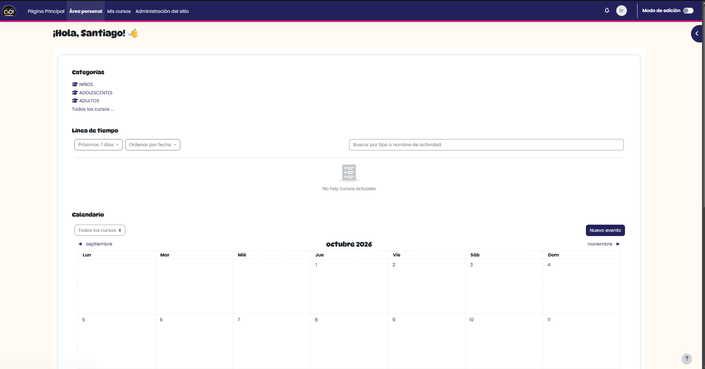
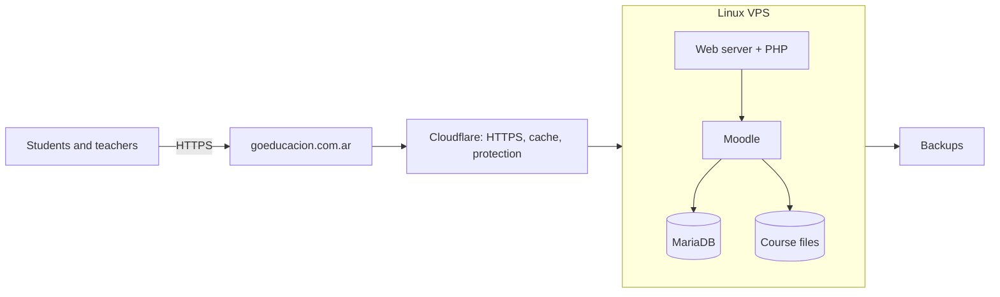
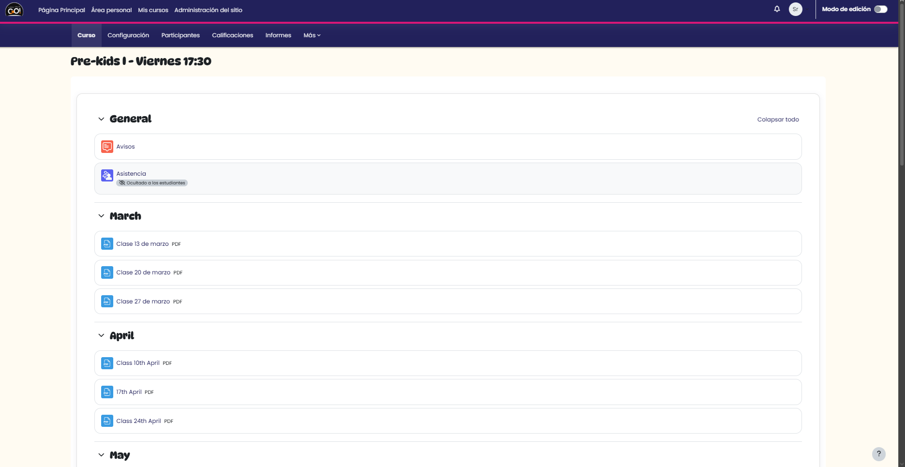

# GO! Educación · Moodle campus (case study)

**A virtual campus for an English institute, used by about 250 students and 10 teachers across 20 courses.** I chose the platform, deployed it on a Linux server behind Cloudflare, planned it for 500 concurrent users and trained every teacher to use it.

<!-- Screenshot of the campus home page, with no student data visible -->

## Context and problem

Instituto GO! is an English language institute in Bahía Blanca, Argentina. Before the campus, course material circulated through WhatsApp: there was no single place where students could find what they needed, and teachers had to share the same content again and again.

## My role

I owned the project end to end, as a freelancer: choosing the platform, deploying and configuring it, training the teachers and maintaining it since launch. The institute contracted the server; everything on it was set up by me.

## Key decisions

**Moodle over Google Classroom.** Moodle is the platform the Universidad Nacional del Sur uses, so it was proven at scale and familiar to me. It is also far more customizable than Google Classroom: roles, enrollment rules, plugins and course structure can all be adapted to how the institute works.

**Planned for 500 concurrent users.** The institute had about 250 students, but I planned for twice that load at the same time, so the campus would keep working during peaks, like exam weeks, and as the institute grew.

**Cloudflare in front of the server.** Every request goes through Cloudflare before reaching the VPS. It terminates HTTPS, serves static files (images, CSS, JavaScript) from its cache and absorbs traffic spikes, so the server only processes what really needs Moodle. It takes load off a single server without paying for a second one.

## Architecture

## What I set up

- Linux VPS administered over SSH
- MariaDB database
- Moodle installation and configuration
- Domain and HTTPS
- Cloudflare as a proxy and CDN in front of the server
- Backups and updates
- Plugins
- Roles, permissions and student enrollment
- 20 courses

## Adoption

A platform only works if people use it. I trained every teacher in person, with a class and a slide deck, and I prepare a new guide or presentation every time a new feature goes live.

## Results

- **About 250 students and 10 teachers** use the campus across **20 courses**.
- Course material that used to circulate on WhatsApp now lives in one place.
- Teachers report a **noticeable improvement in student grades** since the campus launched.
- In production since November 2025, built in about a month.

## Maintenance

Day-to-day maintenance is mostly restoring access for users who get locked out of their accounts and implementing improvements that students request.

## Challenges

The hardest part was handling the expected load on a single server. Planning for 500 concurrent users, I needed a way to absorb traffic peaks without paying for more hardware; my answer was putting Cloudflare in front of the VPS.

## What I'd do differently

I would deploy first and optimize later. I spent a lot of time tuning for a load the campus did not have yet. Today I would launch with a solid default setup, measure real usage, and optimize where the data shows a bottleneck.

## Screenshots

